<p align="center">
  
</p>

<h2 align="center">Hola, soy Hernán</h2>

<p align="center">
  Programador y creador de <b>LuSan PRO</b>. Trabajo con <b>SAP HANA</b>, me especializo en <b>Data Science</b><br>
  y ayudo a empresas a ordenar sus datos, automatizar procesos y crecer con su web y sus redes.
</p>

<p align="center">
  <a href="#"></a>
  <a href="#"></a>
  <a href="mailto:hernanarana88@gmail.com"></a>
</p>

---

### `01 // servicios`

| Servicio | Qué incluye |
| --- | --- |
| **Desarrollo SAP HANA** | Modelado, vistas de cálculo, procedimientos y optimización de consultas |
| **Análisis de datos y dashboards** | Limpieza, exploración y tableros claros para decidir |
| **Modelos predictivos** | Machine Learning aplicado a demanda, clientes y precios |
| **Automatización** | Scripts e integraciones que eliminan tareas manuales |
| **Páginas web** | Sitios, tiendas online y landing pages adaptadas al celular |
| **Marketing en redes** | Instagram y Facebook: contenido, videos y campañas |

---

### `02 // stack`

<p>
  
  
  
  
  
  
  
  
  
  
  
  
  
</p>

---

### `03 // proyectos`

| Proyecto | Qué es | Tecnologías |
| --- | --- | --- |
| [**Punto de Encuentro**](https://github.com/hernanarana/punto-de-encuentro) | Tienda y sitio de servicios técnicos para un cliente real, con panel de administración y pedidos por WhatsApp | React · Firebase · Leaflet |
| [**Herramienta del Sur**](https://github.com/hernanarana/TP-Backend-Entrega-N-1) | E-commerce full stack: API REST, usuarios con JWT y roles | Node.js · Express · MongoDB |
| [**Mi E-commerce**](https://github.com/hernanarana/-mi-e-commerce-Arana) | Tienda con carrito, checkout y órdenes en Firestore | React · Firebase |
| [**TerrorStore**](https://github.com/hernanarana/terrorstore) | E-commerce temático de terror en JavaScript puro | HTML · CSS · JavaScript |

---

### `04 // contacto`

```js
const lusanPro = {
  creador: "Hernán Arana",
  ubicacion: "Argentina · trabajo remoto",
  email: "hernanarana88@gmail.com",
  disponible: true,
};
```

<p align="center"><sub>LuSan PRO · Convertimos tus datos en decisiones</sub></p>
